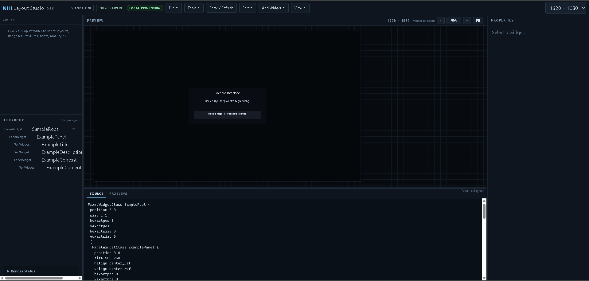
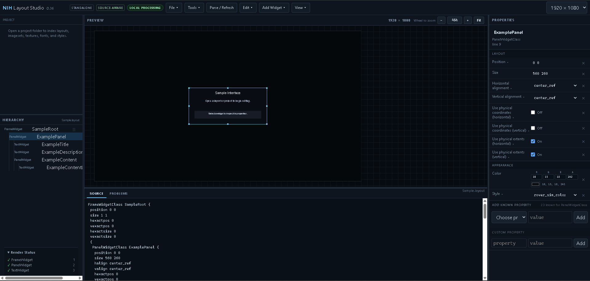
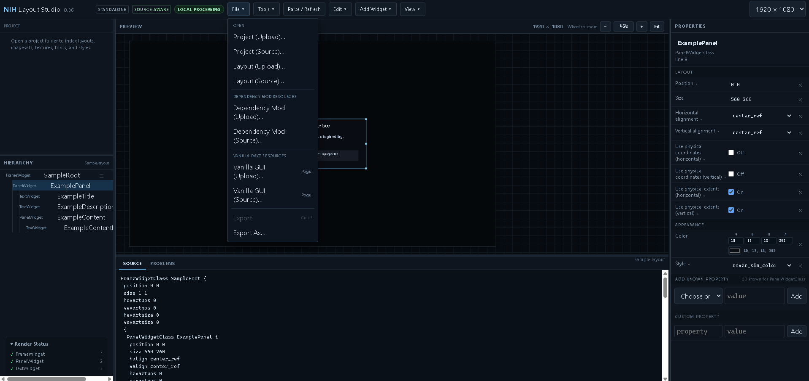
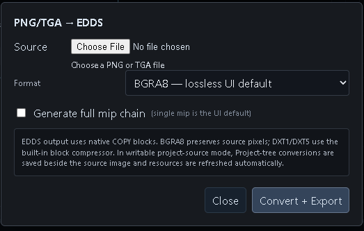
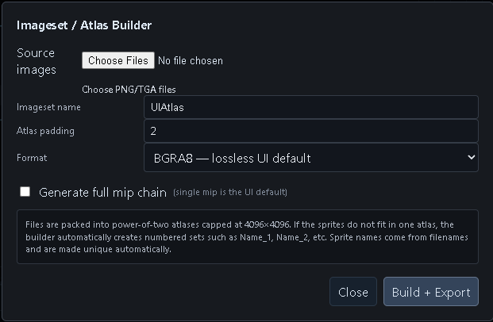

<div align="center">

# NIH Layout Studio

**A browser-based editor and viewer for DayZ / Enfusion `.layout` UI files.**

Edit layouts visually, inspect widget hierarchies and properties, and work with imagesets, styles, and fonts, without depending on Workbench for UI work.

[](https://github.com/NIHDayZ/NIH-Layout-Studio/releases)
[](LICENSE)
[](https://github.com/NIHDayZ/NIH-Layout-Studio/actions/workflows/ci.yml)
[](https://github.com/NIHDayZ/NIH-Layout-Studio/security/code-scanning)
[](https://github.com/NIHDayZ/NIH-Layout-Studio/actions/workflows/dependency-review.yml)
[](https://layout-studio.nihdayz.com)

[**Open the app**](https://layout-studio.nihdayz.com) · [Quick Start](docs/QUICKSTART.md) · [User Guide](docs/USER_GUIDE.md) · [FAQ](docs/FAQ.md)

</div>

---

## What is it?

NIH Layout Studio is a visual editor, renderer, and resource inspector for DayZ / Enfusion `.layout` files. It runs entirely in your browser. You open a layout, see it rendered, select widgets, change their properties, and save the result back to your project.

It understands the resources a layout depends on: imagesets, styles, fonts, and textures. It resolves them from your project, from dependency mods, and from vanilla DayZ GUI files, so the preview looks as close to the game as is practical.

> **Your files stay on your machine.** Layouts, images, fonts, imagesets, and EDDS files are processed locally in your browser. There is no upload server.

## Key features

- **Visual layout editing:** drag, resize, duplicate, copy/paste, reparent, reorder, align, and distribute widgets.
- **Hierarchy and property inspection:** browse the widget tree and edit properties against a schema derived from Workbench definitions, with validation.
- **Source-aware editing:** open a project folder or file directly, then Save and Reload in place (Chromium desktop browsers).
- **Multi-root resource resolution:** project → dependency mods → vanilla `P:\gui`, in that order.
- **Styles:** parses `.styles` files and previews Normal, Focus, Disabled, hover-like, and pressed-like states.
- **Imagesets:** inspect and edit `.imageset` files, and generate atlases.
- **EDDS support:** decode EDDS textures natively and encode PNG/TGA to EDDS.
- **Fonts:** native FNT3 font support.
- **Local file processing:** selected files are handled in the browser. Run the app locally if you need a dependable offline workflow; do not rely on the hosted site being available offline.

See the full list in [docs/FEATURES.md](docs/FEATURES.md).

## Screenshots



*Editor overview — neutral sample layout, canvas, hierarchy, and source.*

| Widget editing | Open files and resources |
| --- | --- |
|  |  |
| Select widgets and edit layout properties | Load layouts, project roots, dependencies, and vanilla resources |

| Texture conversion | Atlas creation |
| --- | --- |
|  |  |
| Convert textures locally | Build named imagesets and atlases from source images |

See the [User Guide](docs/USER_GUIDE.md) for more screenshots and workflow descriptions.

## Quick start

### Option 1: Use the hosted app

1. Open **[layout-studio.nihdayz.com](https://layout-studio.nihdayz.com)**.
2. Choose how to load files:
   - **Source mode:** open a local file or folder and save directly back to it. Best in Chrome or Edge on desktop.
   - **Upload mode:** load a temporary copy into the browser and use **Export / Export As** to save. Works in more browsers.
3. Open a `.layout` file and start editing.

Step-by-step instructions are in the [Quick Start](docs/QUICKSTART.md).

### Option 2: Run it locally

See [Run locally](#run-locally) below.

## Run locally

**Requirements:** Node.js 20.19 or newer (Node.js 22 recommended) and npm.

```bash
git clone https://github.com/NIHDayZ/NIH-Layout-Studio.git
cd NIH-Layout-Studio
npm ci
npm run dev
```

Then open the URL that Vite prints (usually `http://localhost:5173`).

To build and preview a production bundle:

```bash
npm run typecheck
npm run build
npm run preview
```

| Script | What it does |
| --- | --- |
| `npm run dev` | Start the Vite development server |
| `npm run typecheck` | Run the TypeScript type check |
| `npm run build` | Type check and build static files into `dist/` |
| `npm run preview` | Serve the production build locally |

## Supported files and resources

| Type | Support |
| --- | --- |
| `.layout` | Render, inspect, edit, save/export |
| `.styles` | Parse and apply to the preview, including state-aware rendering |
| `.imageset` | Inspect, edit, and generate atlases |
| EDDS textures | Decode for display; encode from PNG/TGA |
| PNG / TGA | Load as images; convert to EDDS |
| FNT3 fonts | Load native DayZ fonts |

### Resource resolution order

When the same resource exists in more than one place, NIH Layout Studio uses the first match:

1. Current project
2. Dependency mods, in load order
3. Vanilla DayZ GUI (`P:\gui`)
4. Fallback / placeholder behavior

Dependency and vanilla roots are **read-only**. Only the current Source-mode project is writable.

## Browser support

| Capability | Chrome / Edge (desktop) | Other browsers |
| --- | --- | --- |
| Upload mode (Export to save) | Yes | Yes |
| Source mode (direct Save / Reload) | Yes | Not available; the menu items are disabled with an explanation |

Source mode relies on the File System Access API. The app detects whether your browser supports it.

## Limitations

- The preview aims for practical fidelity with DayZ / Enfusion. **It is not the game engine.** Runtime-only behavior and some specialized control or state behavior may differ from in-game rendering.
- Source mode requires File System Access API support. Without it, use Upload mode.
- Dependency and vanilla resource roots are read-only.
- The project is under active development. Behavior may change between versions; see the [CHANGELOG](CHANGELOG.md).

Always test final layouts in the game.

## Documentation

| Document | Purpose |
| --- | --- |
| [Quick Start](docs/QUICKSTART.md) | Open your first layout in a few minutes |
| [User Guide](docs/USER_GUIDE.md) | Everyday workflows in detail |
| [Features](docs/FEATURES.md) | What the app can and cannot do |
| [FAQ](docs/FAQ.md) | Common questions |
| [Troubleshooting](docs/TROUBLESHOOTING.md) | Fixes for common problems |
| [Deployment](docs/DEPLOYMENT.md) | Hosting your own copy |
| [Contributing](CONTRIBUTING.md) | Development and pull request guidelines |
| [Security](SECURITY.md) | Reporting vulnerabilities |
| [Changelog](CHANGELOG.md) | Release notes |

## Contributing

Contributions are welcome. Open an issue or discussion first for larger changes, then submit a pull request against `main`. The `main` branch is protected and requires passing CI checks and review.

See [CONTRIBUTING.md](CONTRIBUTING.md) for details.

## License

NIH Layout Studio is **source-available for noncommercial use** under the [PolyForm Noncommercial License 1.0.0](LICENSE). You may use, inspect, modify, and redistribute it for noncommercial purposes under the license terms. Commercial use requires separate written permission from the maintainers.

This is not an OSI-approved open-source license.

## Disclaimer

NIH Layout Studio is an independent community tool. It is not affiliated with or endorsed by Bohemia Interactive. DayZ and Enfusion are trademarks of their respective owners. Vanilla game resources are read from your own installation or extracted game data and are not distributed with this project.